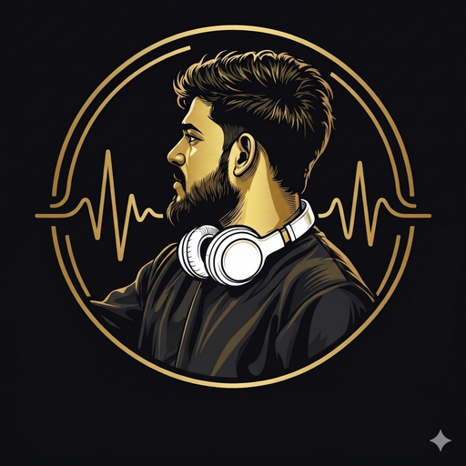

# Notch Dude 🎧🚀

<p align="center">
  
  <br>
  <b>The Ultimate Floating Music Notch & Dynamic Island for Windows 10 & 11</b>
</p>

<p align="center">
  <a href="https://microsoft.com/windows"></a>
  <a href="https://electronjs.org/"></a>
  <a href="LICENSE"></a>
</p>

---

## ✨ Features & Highlights

### 1. 🪟 Ultra-Compact Apple Dynamic Island (240 FPS Fluid Spring)
- **Minimalist Pill**: Resting state is a razor-thin **`112px × 24px`** pill that never obstructs your screen or workspace.
- **Mac ProMotion Dynamics**: High refresh rate (120Hz/144Hz/240Hz) GPU spring motion (`cubic-bezier(0.2, 0.9, 0.2, 1.15)`) that expands instantly to `480px × 185px` on hover and cleanly snaps back on leave.
- **Frosted Glassmorphism**: Translucent backdrop blur (`backdrop-filter: blur(28px) saturate(190%)`) with golden ambient glow.
- **Dual Display Modes**: Toggle between glued **Bezel Notch Mode** and floating **Dynamic Island Mode** anytime.

### 2. 🎵 Built-in YouTube Music Streaming (Native Queue)
- **Zero Ads / Free Streaming**: Direct YouTube audio streaming without web browser tabs or logins.
- **Today's Trending Hits**: Automatically loads fresh daily trending hits on startup.
- **YouTube Suggested Queue (One by One)**: Plays official YouTube Music recommended tracks one after another without looping or repeating.
- **Live Search with 2 Instant Suggestions**: Quick suggestions appear as you type, exactly like YouTube Music.
- **Audio Spectrum Visualizer**: Animated canvas visualizer bars inside the player, plus a live bouncing mini-wave on the resting pill when music is playing.

### 3. 🔊 Windows Master Speaker Volume Synchronization
- Direct Windows CoreAudio control via native bindings.
- Changing volume in Notch Dude adjusts system master volume in real time, and vice versa.
- One-click mute/unmute toggle.

### 4. 📂 File Shelf (Drop Zone)
- Drag and drop files from Windows Explorer directly into Notch Dude.
- Quickly **Open**, **Show in Folder**, or **Copy Path**.

### 5. ⚡ System HUD
- Live Battery percentage, CPU usage, RAM utilization, and system uptime.

### 6. ⌨️ Global Shortcuts
- Press **`Ctrl + Alt + N`** anywhere in Windows to toggle Notch Dude.

---

## 🚀 Getting Started

### Prerequisites
- Windows 10 or Windows 11 (64-bit)
- [Node.js](https://nodejs.org/) (v18+)

### Run Locally
```bash
# Clone the repository
git clone https://github.com/harisaravanan1708-arch/Notch.git
cd Notch

# Install dependencies
npm install

# Start Notch Dude
npm start
```

### Silent Background Launch
Double-click `run-notch.vbs` or `run-notch.bat` to launch quietly in the background without a command prompt window.

---

## 📦 Building Standalone Portable Binary

To generate the standalone executable with the official **Notch Dude** logo and icon:

```bash
# Build win32-x64 portable package with Notch Dude icon
npm run package-win

# Or run the automated updater and zip script:
update-and-zip.bat
```

Output is generated at:
- `dist/Notch Dude-win32-x64/Notch Dude.exe`
- `Notch-Dude.zip`

---

## ⌨️ Controls & Shortcuts

| Action | Shortcut / Trigger |
| :--- | :--- |
| **Toggle Notch Open/Closed** | `Ctrl + Alt + N` (Global) |
| **Expand on Hover** | Hover mouse over the top resting pill |
| **Pin / Keep Open** | Click the Pin icon `[📌]` |
| **Switch Notch / Island Mode** | Click the display toggle icon `[▭]` |
| **Play / Pause Track** | Spacebar / Center Play button |
| **Next Track** | Click `⏭` (plays next suggested track) |
| **Previous Track** | Click `⏮` (replays track or plays previous) |
| **System Mute** | Click the speaker icon |

---

## 📄 License

This project is licensed under the MIT License. See [LICENSE](LICENSE) for details.
